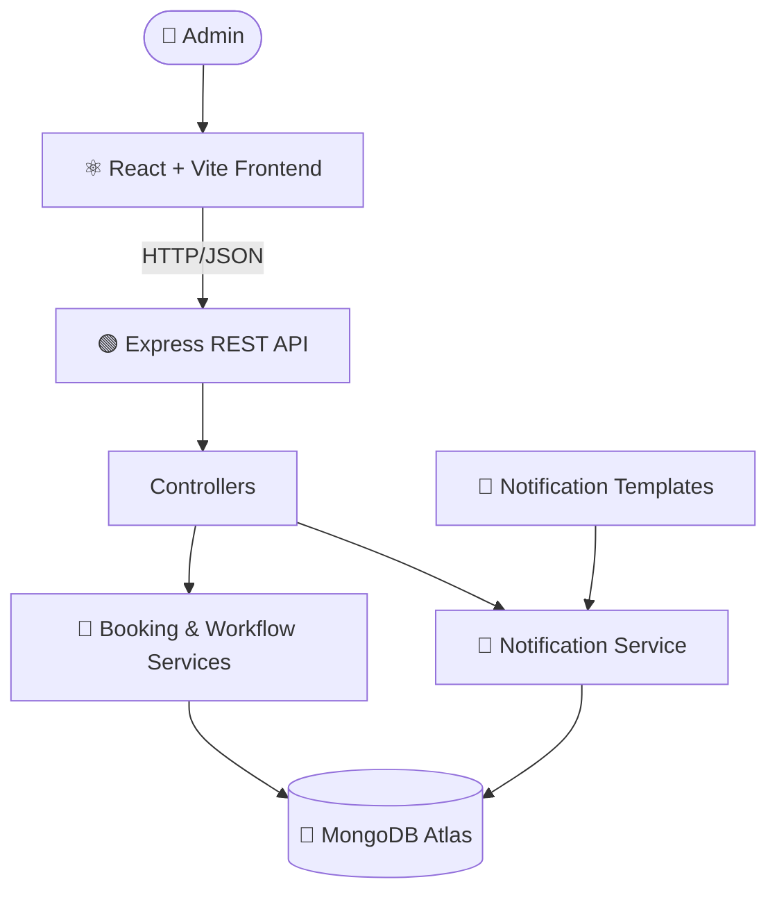

<div align="center">


<br/>

<a href="https://git.io/typing-svg"></a>

<br/>


</div>


## 🌐 Live Demo

<div align="center">

🚀 **PujaFlow is Live!**

Experience the complete puja booking workflow, admin dashboard, and mock WhatsApp notification system.

[](https://aaradhya-setu-assignment.vercel.app)

**🔗 [Launch PujaFlow](https://aaradhya-setu-assignment.vercel.app)**

</div>

## 🪔 About

**PujaFlow** is a full-stack booking workflow and notification management system developed for the Aaradhya Setu Software Engineering Internship Assignment.

The application provides an administrator-facing dashboard to manage puja bookings through four sequential stages. Every booking creation and valid status transition automatically generates a personalized WhatsApp-style notification using predefined templates.

Notifications are stored in MongoDB and can be viewed through individual booking histories or a dedicated WhatsApp Notifications dashboard.

The system incorporates workflow validation, MongoDB transactions, conditional status updates, and persistent notification logging to maintain data consistency.

> **Note:** WhatsApp notifications are mocked. Messages are generated, stored, and displayed in the application but are not delivered to actual phone numbers. No external messaging API is required.


## 🌼 Features

| | Feature | Details |
|---|---|---|
| 🛕 | **Admin dashboard** | View bookings, monitor workflow statistics, and manage puja progress |
| 🔁 | **Guided workflow** | Enforces four sequential stages without skipping or moving backwards |
| 💬 | **Auto notifications** | Booking creation and every valid status transition automatically generate a notification |
| 🧾 | **Dynamic templates** | Personalized messages containing devotee name, puja name, and booking ID |
| 📜 | **Notification history** | Every generated message is persisted in MongoDB and displayed in the UI |
| 🎭 | **Mock WhatsApp** | Messages appear in WhatsApp-style chat bubbles without an external messaging API |
| 📊 | **Booking statistics** | Dashboard displays total bookings and counts for each workflow stage |
| 🔎 | **Search and filters** | Search bookings and filter notification history by workflow stage |
| 🪔 | **Interactive timeline** | Visual representation of completed, current, and upcoming booking stages |
| 🔐 | **Workflow consistency** | MongoDB transactions and conditional updates help prevent inconsistent state changes |
| 📱 | **Responsive interface** | Custom CSS layout designed for desktop, tablet, and mobile screens |


## 🔄 Workflow

```
 ┌──────────────────┐    ┌───────────────┐    ┌─────────────────┐    ┌─────────────────┐
 │ Booking Confirmed│ ─► │ Puja Started  │ ─► │ Puja Completed  │ ─► │ Video Available │
 └──────────────────┘    └───────────────┘    └─────────────────┘    └─────────────────┘
          │                      │                     │                      │
          ▼                      ▼                     ▼                      ▼
     notification           notification          notification           notification
```

A new booking automatically starts with the status `BOOKING_CONFIRMED`.

Administrators can advance the booking through the following sequence:

1. `BOOKING_CONFIRMED`
2. `PUJA_STARTED`
3. `PUJA_COMPLETED`
4. `VIDEO_AVAILABLE`

Each stage generates one corresponding mock WhatsApp notification.

The workflow permits only the next valid transition. Skipping stages, reversing progress, or advancing a booking beyond `VIDEO_AVAILABLE` is not allowed.

A complete booking lifecycle consists of one booking creation request, three status updates, and four generated notifications.

### 💌 Notification templates

| Status | Template |
|---|---|
| `BOOKING_CONFIRMED` | 🙏 Namaste **{{devoteeName}}**, your booking **#{{bookingId}}** for **{{pujaName}}** is confirmed. |
| `PUJA_STARTED` | 🪔 **{{devoteeName}}**, the **{{pujaName}}** (Booking **#{{bookingId}}**) has begun. |
| `PUJA_COMPLETED` | 🌸 **{{devoteeName}}**, your **{{pujaName}}** (Booking **#{{bookingId}}**) is complete. Blessings to you and your family. |
| `VIDEO_AVAILABLE` | 🎥 **{{devoteeName}}**, the video of your **{{pujaName}}** (Booking **#{{bookingId}}**) is now available. |

These examples illustrate the personalized information included in notifications. The exact message wording is defined in `backend/templates/notificationTemplates.js`.


## 🏛️ Architecture



<details>
<summary>ASCII version</summary>

```
                  ADMIN
                    |
                    v
          +-------------------+
          |   React + Vite    |
          |     Frontend      |
          +-------------------+
                    |
                    | HTTP/JSON
                    v
          +-------------------+
          |   Express REST    |
          |       API         |
          +-------------------+
                    |
                    v
          +-------------------+
          |    Controllers    |
          +-------------------+
                    |
          +---------+---------+
          |                   |
          v                   v
  +----------------+  +----------------+
  | Booking &      |  | Notification   |
  | Workflow       |  | Service        |
  | Services       |  |                |
  +----------------+  +----------------+
          |                   |
          |          +----------------+
          |          | Notification   |
          |          | Templates      |
          |          +----------------+
          |                   |
          +---------+---------+
                    |
                    v
          +-------------------+
          |  MongoDB Atlas    |
          |    + Mongoose     |
          +-------------------+
```

</details>

### Database consistency

PujaFlow uses MongoDB transactions to keep booking updates and notification creation consistent.

When an administrator advances a booking:

1. The backend retrieves the existing booking.
2. The workflow service validates the requested status transition.
3. A conditional database update changes the booking status.
4. The notification service generates a personalized message.
5. The notification is saved in MongoDB.
6. Both database operations are committed within the same transaction.

If an operation fails, the transaction can be rolled back, preventing a booking status update from being committed without its corresponding notification.

Conditional updates help detect conflicting concurrent status changes.

A compound unique index on `bookingId` and `status` prevents multiple notifications for the same booking stage.

The application also generates the initial confirmation notification during booking creation within a database transaction.


## 🧰 Tech Stack

| Component | Technology | Purpose |
|---|---|---|
| Frontend | React + Vite | Build the interactive admin dashboard |
| Styling | CSS3 | Create responsive layouts, workflow timelines, and notification cards |
| Icons | Lucide React | Provide consistent dashboard icons |
| HTTP Client | Fetch API | Communicate with backend REST endpoints |
| Backend | Node.js | JavaScript runtime for server-side application logic |
| Framework | Express.js | Handle HTTP requests, routing, and API responses |
| Database | MongoDB Atlas | Persist booking and notification records |
| ODM | Mongoose | Define schemas, perform database operations, and manage transactions |
| API Testing | Postman | Manually verify API functionality and error handling |
| Version Control | Git + GitHub | Track source code and share the project |


## 🗂️ Project Structure

```
PujaFlow/
├── frontend/                       # React + Vite admin dashboard
│   ├── src/
│   │   ├── services/
│   │   │   └── api.js              # Fetch-based API helpers
│   │   ├── App.jsx                 # Dashboard and UI components
│   │   ├── App.css                 # Dashboard and component styling
│   │   ├── index.css               # Global styles
│   │   └── main.jsx                # React entry point
│   ├── package.json
│   ├── vite.config.js
│   └── index.html
│
├── backend/                        # Node.js + Express backend
│   ├── constants/
│   │   └── bookingStatus.js        # Workflow status constants
│   ├── models/
│   │   ├── Booking.js              # Booking schema
│   │   └── Notification.js         # Notification schema
│   ├── services/
│   │   ├── bookingService.js       # Booking operations and transactions
│   │   ├── workflowService.js      # Status transition validation
│   │   └── notificationService.js  # Notification creation and retrieval
│   ├── templates/
│   │   └── notificationTemplates.js
│   ├── controllers/
│   │   └── bookingController.js
│   ├── routes/
│   │   └── bookingRoutes.js
│   ├── package.json
│   └── .env.example
│
├── assets/
│   ├── banner.svg
│   ├── divider.svg
│   └── footer.svg
│
├── .gitignore
└── README.md
```

> **Note:** The tree shows the core application files. The backend entry-point filename should match the actual repository. The `assets/` SVG files and `.env.example` must exist for their corresponding references to work.


## 🗃️ Data Models

### Booking

```js
{
  bookingId: {
    type: String,
    required: true,
    unique: true
  },
  devoteeName: {
    type: String,
    required: true
  },
  pujaName: {
    type: String,
    required: true
  },
  status: {
    type: String,
    enum: [
      "BOOKING_CONFIRMED",
      "PUJA_STARTED",
      "PUJA_COMPLETED",
      "VIDEO_AVAILABLE"
    ],
    default: "BOOKING_CONFIRMED"
  }
}
```

Mongoose timestamps automatically maintain `createdAt` and `updatedAt`.

### Notification

```js
{
  bookingId: {
    type: String,
    required: true
  },
  status: {
    type: String,
    enum: [
      "BOOKING_CONFIRMED",
      "PUJA_STARTED",
      "PUJA_COMPLETED",
      "VIDEO_AVAILABLE"
    ],
    required: true
  },
  channel: {
    type: String,
    default: "WHATSAPP"
  },
  deliveryStatus: {
    type: String,
    default: "MOCKED"
  },
  message: {
    type: String,
    required: true
  }
}
```

Notification records are associated with bookings through `bookingId`.

Each notification stores the workflow stage, generated message, communication channel, mock delivery status, and timestamps.

A unique compound index on `(bookingId, status)` helps prevent duplicate notifications for the same workflow stage.


## 🔌 API Endpoints

| Method | Endpoint | Description |
|---|---|---|
| `POST` | `/api/bookings` | Create a booking and generate its confirmation notification |
| `GET` | `/api/bookings` | Retrieve all bookings |
| `GET` | `/api/bookings/:bookingId` | Retrieve a specific booking |
| `PATCH` | `/api/bookings/:bookingId/status` | Advance to the next valid status and generate a notification |
| `GET` | `/api/bookings/:bookingId/notifications` | Retrieve the notification history for a booking |

### Example: Create a booking

**Request**

```http
POST /api/bookings
Content-Type: application/json
```

```json
{
  "bookingId": "AS1001",
  "devoteeName": "Rahul Sharma",
  "pujaName": "Rudrabhishek Puja"
}
```

The booking is created with the initial status `BOOKING_CONFIRMED`, and a personalized confirmation notification is generated automatically.

### Example: Update booking status

**Request**

```http
PATCH /api/bookings/AS1001/status
Content-Type: application/json
```

```json
{
  "status": "PUJA_STARTED"
}
```

The workflow service validates the transition before updating the booking and creating the corresponding notification.

### Example: Retrieve notification history

```http
GET /api/bookings/AS1001/notifications
```

The endpoint returns the stored notifications associated with booking `AS1001`.

### Error handling

| Scenario | Expected behavior |
|---|---|
| Booking does not exist | Returns `404 Not Found` |
| Invalid status value | Returns `400 Bad Request` |
| Invalid workflow transition | Returns `409 Conflict` |
| Conflicting concurrent update | Returns `409 Conflict` |
| Duplicate booking ID | Database uniqueness constraint prevents duplication |
| Database operation fails | Transaction prevents partial booking/notification updates |

The frontend displays API errors so administrators can identify unsuccessful operations.

> **Notification dashboard implementation:** The dedicated WhatsApp Notifications page retrieves notification histories using the booking-specific endpoint and combines them in the frontend. A separate global notifications API has not been implemented.


## 🚀 Getting Started

### Prerequisites

* Node.js and npm
* MongoDB Atlas account or compatible MongoDB deployment supporting transactions
* Git

### 1. Clone

```bash
git clone https://github.com/agarwalbhargavi/pujaflow.git
cd pujaflow
```

### 2. Backend

```bash
cd backend
npm install
```

Create a `.env` file in the `backend/` directory.

```env
PORT=5001
MONGODB_URI=your_mongodb_atlas_connection_string
```

Replace `your_mongodb_atlas_connection_string` with your MongoDB connection URI.

Start the backend:

```bash
npm run dev
```

The backend runs on port `5001` with the documented configuration.

Ensure that your MongoDB Atlas network access settings permit connections from your development environment.

### 3. Frontend

Open another terminal from the project root:

```bash
cd frontend
npm install
npm run dev
```

Open the local URL displayed by Vite, typically:

```
http://localhost:5173
```

The frontend communicates with the Express backend using the Fetch API.

For an explicit API configuration, create `frontend/.env`:

```env
VITE_API_URL=http://localhost:5001/api
```

Ensure the Express backend allows requests from the frontend origin through CORS.

### 4. Explore PujaFlow

Once both servers are running:

1. Open the admin dashboard.
2. Create a new booking using the **New Booking** button.
3. View the booking in the bookings table.
4. Click **Manage** to open the booking details panel.
5. Advance the booking through its workflow stages.
6. View automatically generated notifications.
7. Open the **WhatsApp Notifications** page to search and filter message history.


## 🧪 Testing with Postman

### Test 1 — Create a booking

Send:

```
POST /api/bookings
```

Request body:

```json
{
  "bookingId": "AS2001",
  "devoteeName": "Priya Sharma",
  "pujaName": "Satyanarayan Puja"
}
```

**Expected:** A new booking is created with status `BOOKING_CONFIRMED`, along with its initial mock WhatsApp notification.

### Test 2 — Start the puja

Send:

```
PATCH /api/bookings/AS2001/status
```

```json
{
  "status": "PUJA_STARTED"
}
```

**Expected:** Booking status changes to `PUJA_STARTED`, and a second notification is generated.

### Test 3 — Complete the puja

Send:

```
PATCH /api/bookings/AS2001/status
```

```json
{
  "status": "PUJA_COMPLETED"
}
```

**Expected:** Booking status changes to `PUJA_COMPLETED`, and a third notification is generated.

### Test 4 — Make video available

Send:

```
PATCH /api/bookings/AS2001/status
```

```json
{
  "status": "VIDEO_AVAILABLE"
}
```

**Expected:** Booking reaches its final status, and a fourth notification is generated.

### Test 5 — Retrieve notification history

Send:

```
GET /api/bookings/AS2001/notifications
```

**Expected:** Four persisted notification records are returned.

### Test 6 — Invalid workflow transition

Attempt to advance a booking beyond `VIDEO_AVAILABLE`, skip a stage, or move backwards.

**Expected:** The backend rejects the invalid transition.

### Test 7 — Duplicate booking

Attempt to create another booking using an existing `bookingId`.

**Expected:** The unique booking ID constraint prevents a duplicate record.

### Test 8 — Data persistence

Refresh the frontend and retrieve the booking again.

**Expected:** The booking’s latest status and notification history remain available in MongoDB.

### Test 9 — Frontend notification filters

Open the **WhatsApp Notifications** page.

Verify that search and workflow-stage filters correctly display matching messages.

**Complete workflow:** One booking creation request + three valid status updates = four stored mock WhatsApp notifications.


## 🗺️ Roadmap

### Core Features Implemented

- [x] Booking model and REST APIs
- [x] Sequential four-stage workflow
- [x] Workflow transition validation
- [x] Template-based personalized notifications
- [x] Automatic mock WhatsApp notification generation
- [x] Persistent notification history
- [x] MongoDB transactions
- [x] Conditional status updates for concurrency protection
- [x] Admin dashboard
- [x] Booking creation interface
- [x] Booking search
- [x] Interactive booking timeline
- [x] Dedicated WhatsApp Notifications page
- [x] Notification search and status filters
- [x] Responsive frontend

### Future Enhancements

- [ ] Automated unit and integration tests
- [ ] Authentication and role-based access control
- [ ] Paginated booking and notification APIs
- [ ] Real WhatsApp Business API integration (optional)
- [ ] Devotee-facing booking page


## 👩‍💻 Author

**Bhargavi**

[](https://github.com/agarwalbhargavi)
[](https://linkedin.com/in/bhargavi-agarwal-345675270)
[](https://bhargavi-portfolio-one.vercel.app)

<br/>


<div align="center">

⭐ If you liked this project, give it a star.

</div>
