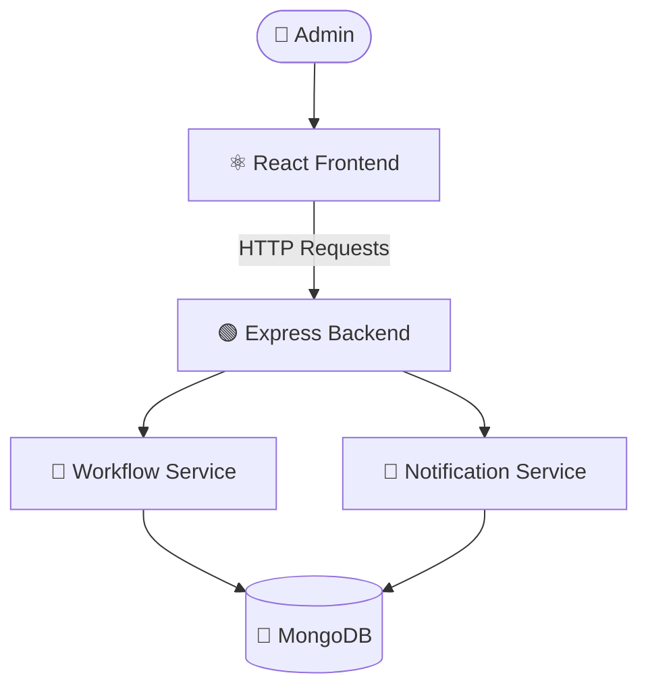

<div align="center">



<br/>

<a href="https://git.io/typing-svg"></a>

<br/>


</div>


## 🪔 About

**PujaFlow** is a full-stack workflow system for managing puja bookings. An admin moves each booking through four stages, and every transition automatically generates a **WhatsApp-style notification** for the devotee, built from a template and saved to a history log.

> WhatsApp messages are **mocked**. No real messaging API is needed.


## 🌼 Features

| | Feature | Details |
|---|---|---|
| 🛕 | **Admin dashboard** | View all bookings and move any booking to its next stage with one click |
| 🔁 | **Guided workflow** | Strict, ordered status flow, with no skipping and no going backwards |
| 💬 | **Auto notifications** | Every status change instantly creates a notification message |
| 🧾 | **Dynamic templates** | Messages filled with the devotee name, Puja name and booking ID |
| 📜 | **Notification history** | Every message is saved in MongoDB and shown in the UI |
| 🎭 | **Mock WhatsApp** | Messages are logged and displayed like chat bubbles, with no external API |


## 🔄 Workflow

```
 ┌──────────────────┐    ┌───────────────┐    ┌─────────────────┐    ┌─────────────────┐
 │ Booking Confirmed│ ─► │ Puja Started  │ ─► │ Puja Completed  │ ─► │ Video Available │
 └──────────────────┘    └───────────────┘    └─────────────────┘    └─────────────────┘
          │                      │                     │                      │
          ▼                      ▼                     ▼                      ▼
     notification           notification          notification           notification
```

### 💌 Notification templates

| Status | Template |
|---|---|
| `BOOKING_CONFIRMED` | 🙏 Namaste **{{devoteeName}}**, your booking **#{{bookingId}}** for **{{pujaName}}** is confirmed. |
| `PUJA_STARTED` | 🪔 **{{devoteeName}}**, the **{{pujaName}}** (Booking **#{{bookingId}}**) has begun. |
| `PUJA_COMPLETED` | 🌸 **{{devoteeName}}**, your **{{pujaName}}** (Booking **#{{bookingId}}**) is complete. Blessings to you and your family. |
| `VIDEO_AVAILABLE` | 🎥 **{{devoteeName}}**, the video of your **{{pujaName}}** (Booking **#{{bookingId}}**) is now available. |


## 🏛️ Architecture



<details>
<summary>ASCII version</summary>

```
                ADMIN
                  |
                  v
         +------------------+
         |  React Frontend  |
         +------------------+
                  |
                  | HTTP Requests
                  v
         +------------------+
         |  Express Backend |
         +------------------+
                  |
         +--------+--------+
         |                 |
         v                 v
  +-------------+   +----------------+
  |  Workflow   |   | Notification   |
  |  Service    |   | Service        |
  +-------------+   +----------------+
         |                 |
         +--------+--------+
                  |
                  v
         +------------------+
         |     MongoDB      |
         +------------------+
```

</details>


## 🧰 Tech Stack

| Component | Technology | Purpose |
|---|---|---|
| Frontend | React + Vite | Build the admin interface |
| Styling | Tailwind CSS | Create a responsive, professional UI |
| Backend | Node.js | Run JavaScript on the server |
| Framework | Express.js | Build REST APIs |
| Database | MongoDB | Store bookings and notifications |
| ODM | Mongoose | Define schemas and interact with MongoDB |
| API testing | Postman | Test backend endpoints |
| Version control | Git + GitHub | Track changes and share the project |


## 🗂️ Project Structure

```
PujaFlow/
├── client/                    # React + Vite admin UI
│   └── src/
│       ├── components/        # BookingTable, StatusButton, NotificationList
│       ├── pages/             # Dashboard, BookingDetails
│       └── api/               # Axios helpers
├── server/
│   ├── config/                # DB connection
│   ├── models/                # Booking.js, Notification.js
│   ├── services/
│   │   ├── workflowService.js       # status transitions + validation
│   │   └── notificationService.js   # templates + mock WhatsApp
│   ├── controllers/
│   ├── routes/
│   └── server.js
└── README.md
```


## 🗃️ Data Models

**Booking**

```js
{
  devoteeName: String,
  phone: String,
  pujaName: String,
  status: {
    type: String,
    enum: ["BOOKING_CONFIRMED", "PUJA_STARTED", "PUJA_COMPLETED", "VIDEO_AVAILABLE"],
    default: "BOOKING_CONFIRMED"
  },
  createdAt: Date
}
```

**Notification**

```js
{
  booking: { type: ObjectId, ref: "Booking" },
  status: String,
  message: String,
  channel: { type: String, default: "WHATSAPP_MOCK" },
  sentAt: Date
}
```


## 🔌 API Endpoints

| Method | Endpoint | Description |
|---|---|---|
| `POST` | `/api/bookings` | Create a booking (starts at *Booking Confirmed*) |
| `GET` | `/api/bookings` | List all bookings |
| `GET` | `/api/bookings/:id` | Get a single booking |
| `PATCH` | `/api/bookings/:id/status` | Move to the next status and trigger a notification |
| `GET` | `/api/notifications` | Full notification history |
| `GET` | `/api/notifications/booking/:id` | Notifications for one booking |


## 🚀 Getting Started

### Prerequisites

- Node.js 18+
- MongoDB (local or Atlas)
- Git

### 1. Clone

```bash
git clone https://github.com/agarwalbhargavi/pujaflow.git
cd pujaflow
```

### 2. Backend

```bash
cd server
npm install
cp .env.example .env     # add your MongoDB URI
npm run dev
```

`.env`

```env
PORT=5000
MONGO_URI=mongodb://localhost:27017/pujaflow
```

### 3. Frontend

```bash
cd client
npm install
npm run dev
```

Open **http://localhost:5173** 🎉


## 🧪 Testing with Postman

1. `POST /api/bookings` with a devotee name, phone and Puja name
2. `PATCH /api/bookings/:id/status` four times, once per stage
3. `GET /api/notifications/booking/:id` to see the generated messages


## 🗺️ Roadmap

- [x] Booking model and REST APIs
- [x] Sequential workflow service
- [x] Template-based notifications
- [x] Notification history
- [ ] Admin dashboard UI polish
- [ ] Filters and search on bookings
- [ ] Real WhatsApp integration (optional)
- [ ] Devotee-facing booking page


## 👩‍💻 Author

**Bhargavi**

[](https://github.com/agarwalbhargavi)
[](https://linkedin.com/in/bhargavi-agarwal-345675270)
[](https://bhargavi-portfolio-one.vercel.app)

<br/>


<div align="center">

⭐ If you liked this project, give it a star.

</div>
